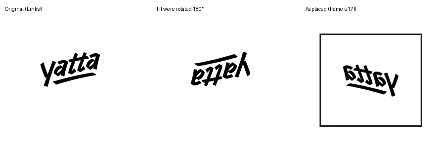

# Checker spot checks

Hand-verified results: open the IDML XML, work out what each check should report from InDesign's data model,
and compare with the checker. Done before the refactor (phase 0) and again for any change that alters a check's
meaning. Automated equivalents live in `python_backend/testing/oracle/`.

Notation: `ItemTransform="a b c d tx ty"` maps a point (x, y) to (a·x + c·y + tx, b·x + d·y + ty).
Determinant `a·d − b·c` < 0 means the item is mirrored (flipped). Rotation is `atan2(b, a)`.

---

## 2026-10-10 — *Full coverage errors Folder.zip* (end-to-end fail data)

| Check | By hand from the XML | Checker | Verdict |
|-------|----------------------|---------|---------|
| Text columns | Frame `u127`: `TextFramePreference TextColumnCount="2"`; every other frame is 1 | `u127` | ✅ |
| Linked text frames | Frames `u151` and `u1d5` have `NextTextFrame`/`PreviousTextFrame` ≠ `n` | `u151`, `u1d5` | ✅ |
| Embedded image | One `<Link StoredState="Embedded">`, inside frame `u176` | `u176` | ✅ |
| Document bleed | `DocumentPreference` bleed offsets 72/72/72/72 pt | one warning "72pt" ×4 | ✅ |
| Kerning | Every used paragraph style resolves `KerningMethod` to `$ID/Metrics` through `BasedOn` | none | ✅ |
| Composer | `NormalParagraphStyle` sets no `Composer`; its `BasedOn` is `[No paragraph style]`, which has `Composer="HL Composer"` → should warn "Inherited from: ParagraphStyle/$ID/[No paragraph style]" | warns `NormalParagraphStyle` with **empty** context | ❌ **B2** |
| Image transform — frame `u188` | `1 0 −0.364 1`: no rotation (`atan2(0, 1)` = 0°); `c` = −0.364 = tan(−20°) → 20° skew | skew, `c=-0.36` | ✅ |
| Image transform — frame `u17f` | `−1 0 0 1`: x mirrored, y unchanged, determinant −1 → **horizontal flip** (a 180° turn would be `−1 0 0 −1`) | "rotated by 180.00 degrees" (warning) | ❌ **B7** |

Rendered from the package's own PDF export: the placed logo reads backwards but isn't upside down, so it's
mirrored, not rotated. Its image inside the frame isn't mirrored, so the end state is a flip.

| Image inside `u188` | `0.2467 0 0 0.2467`: uniform scale only | none | ✅ |

## 2026-10-10 — *Image Transformation Folder.zip* (unit test pass data, also in 13 other suites)

| Item | By hand | Checker | Verdict |
|------|---------|---------|---------|
| Container `uea`, `−1 0 0 1` | Horizontal flip (det −1) | "rotated by 180.00 degrees" | ❌ **B7** |
| An image `0 −4.42 −4.42 0` | x axis → (0, −4.42), y axis → (−4.42, 0): a −90° turn of a mirrored image (det −19.5) → flip | "rotated by −90.00 degrees" | ❌ **B7** |

**Rule (confirmed):** judge the *end state*. If the item ends up only rotated (and scaled), it's a warning; if it
ends up mirrored, it's a flip error. For every flagged item in the test set, combining the frame's and the image's
transforms still leaves it mirrored. None cancel out, so all 21 packages' cases are flips under this rule.

## 2026-10-10 — *SEMCO1 Fixed.zip* (composer pass data): kerning set on text

`Stories/Story_u3626.xml`: the run "See " has `KerningMethod="$ID/Optical"` set directly on its
`CharacterStyleRange`; its character style `[No character style]` sets no kerning. The checker reports no
kerning error, only 4 override warnings.

**Verdict: correct, by rule.** Kerning and composer are judged on paragraph/character styles only; values set on
the text are overrides, which the overrides check reports and the paragraph-style rule makes people fix anyway.

## 2026-10-10 — built package: facing-page spread

Two-page spread, a linked text frame placed on the right-hand page (`page1`, "2") at (50, 60, 200 × 100).
Highlight bounds: `page1`, (50, 60, 200, 100) ✅. Issue's page: `page0` / "1" ❌ **B5**
(`testing/fixtures/test_known_bugs.py`).

## 2026-10-10 — built package: no `MasterSpreads/`

A valid IDML without master spreads (allowed by InDesign) crashes at `MASTERPAGE_CHECK` with `AttributeError`
❌ **B1** (`testing/fixtures/test_known_bugs.py`).

---

## Phase 1 verification (B2, B4, B5, B7)

Golden results changed in 110 of 187 packages. Every change was accounted for, order-independently:
980 `text_box_data` page fields (B4), 18 composer contexts (B2), 33 rotation warnings → flip errors
(19 frames, 14 images; B7), 4 issues moved to the facing page (B5). Nothing else changed. The oracle agrees with
the checker on all 10 checks, all packages.

### B5 — *Brochure_Bad.zip*, frame `u17a` (paragraph style + override issues)

| | By hand | Before | After |
|-|---------|--------|-------|
| Frame | `ItemTransform 1 0 0 1 148.0 −93.7`, anchors x −67.2…162.4 → spread x **80.8…310.4** | | |
| Page `u138` "2" | translate −1626.1, bounds left/right 1030.9/1626.1 → spread x −595.3…0 (left page) | ← reported here | |
| Page `u139` "3" | translate −1030.9 → spread x 0…595.3 (right page) | | ← reported here ✅ |

### B4 — *All_err_and_warn.zip*, text box data

Spread page `<Page Self="ud3" Name="1">`. Before: `page_id: "1", page_name: ""` (name in the id field).
After: `page_id: "ud3", page_name: "1"` ✅

### B2 — composer context

*Full coverage errors Folder*: `NormalParagraphStyle` has no `Composer`; `BasedOn` → `[No paragraph style]`, which
sets `Composer="HL Composer"`. After: "Inherited from: ParagraphStyle/$ID/[No paragraph style]" ✅ (was empty).

### B7 — flips

*Full coverage errors Folder* frame `u17f` (`−1 0 0 1`, rendered above): now "Image Container has a horizontal flip
transformation." (error) ✅. *Master Page.zip* images `0 −s −s 0` (mirrored + turned): now "has a flip
transformation." (error) ✅. Guards: `1 0 0 −1` stays "vertical flip"; `−1 0 0 −1` (a real 180° turn) stays a
rotation warning (`testing/fixtures/test_visible_fixes.py`).
